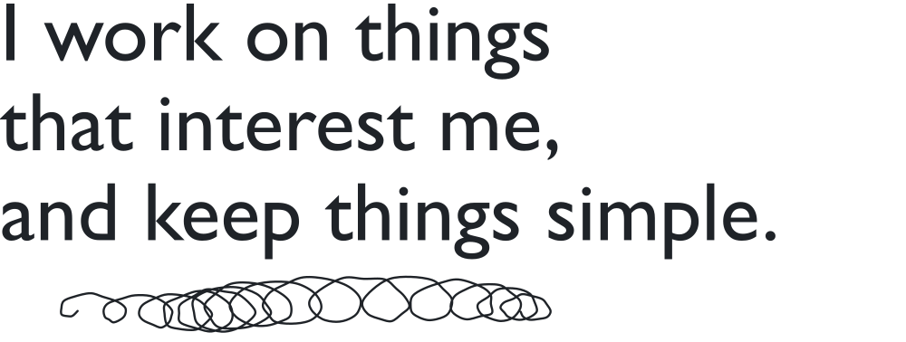
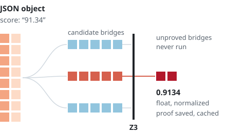
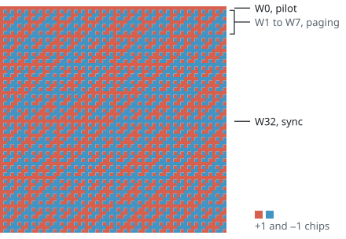

<picture>
  <source media="(prefers-color-scheme: dark)" srcset="assets/hero-dark.svg" />
  <source media="(prefers-color-scheme: light)" srcset="assets/hero-light.svg" />
  
</picture>

 

I build software that shows its working. A shell where a data transform runs only after it has been proved, and experiments that look inside language models to check what they are actually doing, including when the answer turns out to be no.

I'm building [Morphism Engine](https://github.com/Morphism-Engine), studying at SRM (class of 2028), and was an AI developer intern at Kambaa.

 

<picture>
  <source media="(prefers-color-scheme: dark)" srcset="assets/morphism-dark.svg" />
  <source media="(prefers-color-scheme: light)" srcset="assets/morphism-light.svg" />
  
</picture>

### [Morphism Engine](https://github.com/Tejo0507/morphism-engine)

Unix pipes trust whatever the previous stage prints. Morphism infers the schema on both sides of every `|`, and when they disagree, a local model drafts a bridge between them.

The model only proposes. A bridge runs after Z3 has proved it, and every attempt leaves a proof artifact behind. Proved bridges are cached in SQLite, so the same repair is never synthesised twice.

Python, Z3, SQLite, Apache Arrow, Textual.

 
 

<picture>
  <source media="(prefers-color-scheme: dark)" srcset="assets/tail-dark.svg" />
  <source media="(prefers-color-scheme: light)" srcset="assets/tail-light.svg" />
  
</picture>

### [The answer-stable tail](https://github.com/Tejo0507/NLAutoencoders-AnswerStableTail)

Reasoning models often keep writing after the answer has settled. The easy story is that they are checking their work.

This study reads residual-stream activations back as natural language and asks whether that readout can tell when to stop better than cheap signals can. The protocol committed, before any data came in, to reporting a negative result with the same weight as a positive one. Over 250 traces, it was negative.

 
 

<picture>
  <source media="(prefers-color-scheme: dark)" srcset="assets/pumping-dark.svg" />
  <source media="(prefers-color-scheme: light)" srcset="assets/pumping-light.svg" />
  
</picture>

### [Paradox Lab](https://paradox-lab.vercel.app)

Formal language theory as a crime scene. Cut a string into *uvxyz*, pump *v* and *y*, and watch it fall out of anbncn. Then step a pushdown automaton through its stack one transition at a time.

Every verdict is computed in the browser by tested logic; nothing is pre-recorded. [Source](https://github.com/Tejo0507/paradox-lab).

React, TypeScript, Vite, Vitest, Playwright.

 
 

<picture>
  <source media="(prefers-color-scheme: dark)" srcset="assets/walsh-dark.svg" />
  <source media="(prefers-color-scheme: light)" srcset="assets/walsh-light.svg" />
  
</picture>

### [IS-95 Signal Explorer](https://is95-signal-explorer.vercel.app)

A CDMA lab built for a wireless communication course. The order-64 Walsh family on the left, the m-sequences and the masked long-code generator are all computed live, not drawn.

Where the course reference gives no value, the page says so instead of inventing one. [Source](https://github.com/Tejo0507/is95-signal-explorer).

React, TypeScript, Vite.

 
 

### Also

[**QuantDiag**](https://github.com/Tejo0507/QuantDiag) compares a 4-bit model's chain of thought with its full-precision self, to find the components responsible when reasoning breaks. In progress.

[**SecureDerm AI**](https://github.com/Tejo0507/securederm-ai) lets hospitals train one wound classifier without a single image leaving the building, using federated learning with differentially private updates.

[**NeuralRAG**](https://github.com/Tejo0507/NeuralRAG-TrainableIndex) trains the retrieval index alongside the generator: learned centroid routing, product quantization, soft retrieval, evaluated on BEIR.

[**Hallucina**](https://hallucina.vercel.app) is for looking at what image models do between the prompt and the picture.

[**Enterprise Data Agent**](https://github.com/Tejo0507/Enterprise-Data-Agent) answers plain-English questions over enterprise databases, with schema retrieval and an audit log.

 

<picture>
  <source media="(prefers-color-scheme: dark)" srcset="assets/coda-dark.svg" />
  <source media="(prefers-color-scheme: light)" srcset="assets/coda-light.svg" />
  
</picture>

More at [tejosridhar.me](https://www.tejosridhar.me), and I'm on [LinkedIn](https://www.linkedin.com/in/tejosridhar) and [Instagram](https://www.instagram.com/me.tejo/).
