<picture>
  <source media="(prefers-color-scheme: dark)" srcset="assets/header-dark.svg" />
  <source media="(prefers-color-scheme: light)" srcset="assets/header-light.svg" />
  
</picture>

<picture>
  <source media="(prefers-color-scheme: dark)" srcset="https://raw.githubusercontent.com/Tejo0507/Tejo0507/output/dark_mode.svg" />
  <source media="(prefers-color-scheme: light)" srcset="https://raw.githubusercontent.com/Tejo0507/Tejo0507/output/light_mode.svg" />
  
</picture>

### `01` research

<table>
<tr>
<td width="50%" valign="top">

**[NLA · Answer-Stable Tail](https://github.com/Tejo0507/NLAutoencoders-AnswerStableTail)** 
Reasoning models keep checking an answer they already have. Can a natural-language readout of residual-stream activations spot that tail better than cheap signals? 250 traces, success criteria fixed before any data came in. It doesn't. 
<code>interpretability</code> <code>reasoning traces</code> <code>python</code>

</td>
<td width="50%" valign="top">

**[QuantDiag](https://github.com/Tejo0507/QuantDiag)** 
Where does reasoning break once an LLM is quantized? Diagnoses the failures and localizes them. 
<code>quantization</code> <code>llm eval</code> <code>python</code>

</td>
</tr>
<tr>
<td width="50%" valign="top">

**[NeuralRAG · Trainable Index](https://github.com/Tejo0507/NeuralRAG-TrainableIndex)** 
RAG where the index learns too: centroid routing, product quantization and soft retrieval, trained jointly with the generator. Evaluated on BEIR. 
<code>retrieval</code> <code>infonce</code> <code>faiss</code> <code>pytorch</code>

</td>
<td width="50%" valign="top">

**[Hallucina](https://github.com/Tejo0507/Hallucina)** · [live](https://hallucina.vercel.app) 
What happens between the prompt and the picture: adversarial generation, activation extraction and embedding views for image models. 
<code>generative models</code> <code>python</code> <code>js</code>

</td>
</tr>
</table>

### `02` systems

<table>
<tr>
<td width="50%" valign="top">

**[morphism-engine](https://github.com/Tejo0507/morphism-engine)** 
Makes broken CLI data pipes work again. Spots schema mismatches, drafts the fix with a local model and proves every transform with Z3 before it runs. 
<code>z3 smt</code> <code>program synthesis</code> <code>python</code>

</td>
<td width="50%" valign="top">

**[securederm-ai](https://github.com/Tejo0507/securederm-ai)** 
Hospitals train one wound classifier together without sharing a single image. Differentially private local updates, federated aggregation. 
<code>federated learning</code> <code>opacus</code> <code>resnet18</code>

</td>
</tr>
<tr>
<td width="50%" valign="top">

**[Enterprise Data Agent](https://github.com/Tejo0507/Enterprise-Data-Agent)** 
Ask a database a question in plain English. Multi-stage agent pipeline, schema retrieval, SQL generation, audit logging. 
<code>langgraph</code> <code>fastapi</code> <code>next.js</code>

</td>
<td width="50%" valign="top">

**[Repora](https://github.com/Tejo0507/Repora)** · [live](https://repora-tejo.vercel.app) 
Paste a GitHub URL, get a structured read of the codebase: layout, stack, the files that matter. 
<code>github api</code> <code>python</code>

</td>
</tr>
</table>

### `03` built for the browser

<table>
<tr>
<td width="50%" valign="top">

**[PARADOX LAB](https://github.com/Tejo0507/paradox-lab)** · [live](https://paradox-lab.vercel.app) 
Formal languages as a crime scene. Cut and pump strings through the CFL pumping lemma, step a pushdown automaton, watch a DFA lose. 
<code>react</code> <code>typescript</code> <code>vitest</code>

</td>
<td width="50%" valign="top">

**[IS-95 Signal Explorer](https://github.com/Tejo0507/is95-signal-explorer)** · [live](https://is95-signal-explorer.vercel.app) 
A CDMA lab where nothing is pre-drawn: Walsh codes, m-sequences and long-code masks are computed live. 
<code>react</code> <code>typescript</code> <code>dsp</code>

</td>
</tr>
</table>

### `04` stack

<picture>
  <source media="(prefers-color-scheme: dark)" srcset="https://skillicons.dev/icons?i=py,ts,js,java,cpp,c,pytorch,tensorflow,sklearn,opencv,fastapi,react,nextjs,vite,nodejs,spring,postgres,mysql,docker,git,linux,vercel&perline=11&theme=dark" />
  <source media="(prefers-color-scheme: light)" srcset="https://skillicons.dev/icons?i=py,ts,js,java,cpp,c,pytorch,tensorflow,sklearn,opencv,fastapi,react,nextjs,vite,nodejs,spring,postgres,mysql,docker,git,linux,vercel&perline=11&theme=light" />
  
</picture>

also &nbsp;`langgraph` `z3` `opacus` `faiss` `transformers` `whisper` `yolov8` `streamlit`

### `05` contributions

<picture>
  <source media="(prefers-color-scheme: dark)" srcset="https://raw.githubusercontent.com/Tejo0507/Tejo0507/output/profile-3d-contrib/profile-night-green.svg" />
  <source media="(prefers-color-scheme: light)" srcset="https://raw.githubusercontent.com/Tejo0507/Tejo0507/output/profile-3d-contrib/profile-green-animate.svg" />
  
</picture>

insert coin

 
<picture>
  <source media="(prefers-color-scheme: dark)" srcset="https://raw.githubusercontent.com/Tejo0507/Tejo0507/output/pacman-contribution-graph-dark.svg" />
  <source media="(prefers-color-scheme: light)" srcset="https://raw.githubusercontent.com/Tejo0507/Tejo0507/output/pacman-contribution-graph.svg" />
  
</picture>

 

  
    <a href="https://www.tejosridhar.me">tejosridhar.me</a> &nbsp;·&nbsp;
    <a href="https://www.linkedin.com/in/tejosridhar">linkedin</a> &nbsp;·&nbsp;
    <a href="https://www.instagram.com/me.tejo/">instagram</a> &nbsp;·&nbsp;
    <a href="https://github.com/Morphism-Engine">@Morphism-Engine</a>
  

